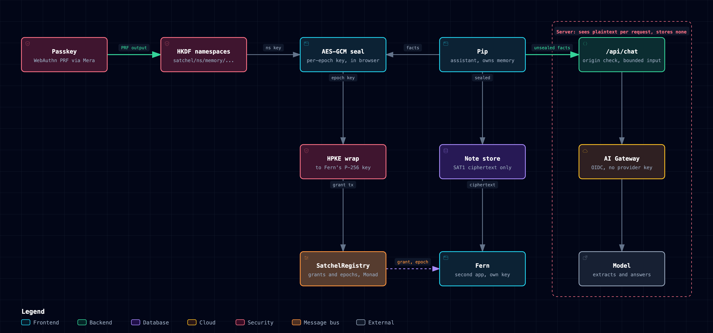

# satchel

Your AI assistant's memory, sealed to your passkey. Tell Pip who you are, grant Fern the memories it needs, and when you revoke, Fern forgets.

Live: https://satchel-keys.vercel.app (Monad testnet, chain 10143). SDK: [`satchel-sdk@0.1.0`](https://www.npmjs.com/package/satchel-sdk) on npm. Registry: `0xd6c895f5c9254dc6eaafc335fff0930fd7012e6d`.

[](docs/architecture.html)

## The loop

1. **Tell Pip.** Pip is an AI assistant. Say "I'm vegetarian" and "I fly out of BLR" and the model extracts each durable fact through a `remember` tool call. The browser seals every fact with a key derived from your passkey and stores only the ciphertext.
2. **Grant Fern.** Fern is a second AI app with its own key. One transaction on Monad records an HPKE wrap of the memory's epoch key to Fern's public key.
3. **Fern plans with them.** Fern rebuilds the grant from the transaction hash, opens your memories and plans a weekend around the food and the airport.
4. **Revoke.** One transaction moves the namespace to the next epoch. Pip reseals every memory at the new epoch.
5. **Fern forgets.** Fern's next read of any memory fails with `GRANT_REVOKED`, and its answer no longer uses what you told Pip.

The chat is a bounded serverless function (`api/chat.ts`): AI SDK through Vercel AI Gateway, authenticated by the project's OIDC token, so no provider key exists in the repo. The browser sends plaintext only for the memories it has just unsealed, the function keeps none of it, and it checks the request origin and caps input size and rate.

## The SDK other apps import

`satchel-sdk` is the layer under both apps: one passkey, many namespaced keys, revocable grants.

```sh
npm i satchel-sdk @category-labs/mera@0.2.0
```

```ts
import { openOrEnrol, ns } from "satchel-sdk";

// mode is read on a first visit only: "enrol" creates a passkey, "open" uses one the person already has
const s = await openOrEnrol({ rpId: location.hostname, appName: "My app", mode });
const memory = ns("memory/assistant");
const blob = await s.seal(memory, { likes: "metric units" });                 // Sealed, safe to store anywhere
const back = await s.unsealJson(memory, blob);                                // { likes: "metric units" }
```

Hand a second app a revocable grant:

```ts
import { createGrantee, fetchGrant, ns } from "satchel-sdk";

// App B (another origin) keeps its own P-256 key. It never touches the passkey.
const appB = await createGrantee();

// App A, with the person's session: one transaction on Monad.
const memory = ns("memory/assistant");
const grant = await s.grant(memory, appB.publicKey, { label: "App B" });

// App B rebuilds the grant from the transaction hash alone and reads.
const g = await fetchGrant({ txHash: grant.txHash, registry: REGISTRY, ns: memory });
await appB.reader(g).unsealJson(blob);                                       // { likes: "metric units" }

// Revoke: the namespace moves to the next epoch for every reader.
await s.revoke(memory, grant.id);
const fresh = await s.seal(memory, { likes: "tea" });                        // sealed at epoch 2
await appB.reader(g).unseal(fresh);                                          // throws GRANT_REVOKED
```

- `derive`: HKDF namespaces from the passkey's PRF output. One prompt yields any number of isolated keys; a namespace's fingerprint is the same on every device that holds the passkey.
- `seal` / `unseal`: AES-256-GCM, a per-epoch data key, the header bound as authenticated data. A different passkey fails closed with `WRONG_PASSKEY`, a different namespace with `NAMESPACE_MISMATCH`.
- `grant` / `fetchGrant`: an HPKE (RFC 9180, P-256) wrap of the epoch key to another app's own key, recorded in `SatchelRegistry`.
- `revoke` / `regrant`: revoke moves a namespace to the next epoch for every reader; `regrant` issues the fresh grant a remaining reader needs. Other namespaces stay at their epoch.
- `addPasskey`: a second passkey opens the same namespaces.

Full reference: `packages/sdk/README.md` and the `/docs` route of the live site.

## Contracts

`SatchelRegistry` on Monad testnet (chain 10143), deployed in tx `0x6d366472a4824adf46538492bf0feb94019bd332c997bcc98ae5586c3c114300`, block 67514971.

| Function | Does |
|---|---|
| `grant(nsHash, granteeKeyHash, wrappedKey, label)` | Records an HPKE-wrapped epoch key for a reader at the owner's current epoch; emits `Granted` |
| `revoke(nsHash, grantId)` | Deactivates the grant and moves the owner's namespace to the next epoch; emits `Revoked` |
| `rotate(nsHash)` | Moves a namespace to the next epoch without a grant; emits `Rotated` |
| `epochOf(owner, nsHash)` | The current epoch of a namespace |
| `grantOf(grantId)` | Owner, namespace hash, epoch, grantee key hash and active flag |

Only the grant's owner can revoke it (`NotGrantOwner`). Address, ABI and smoke-test transactions live in `deployments/`.

## Proof

Chain facts below were read with `cast` against `https://testnet-rpc.monad.xyz` (head block 70656266 at read time), not through the SDK.

| Claim | Evidence |
|---|---|
| The registry is live on Monad testnet | `cast chain-id` returns 10143; `cast code 0xd6c895f5...2012e6d` returns 3,545 hex characters; the deploy receipt `0x6d366472...c114300` has status 1 |
| A Pip to Fern loop ran in a browser with a virtual authenticator with PRF: two facts sealed at epoch 1, Fern grant 35, revoke, Fern reads 0 of 2 as `GRANT_REVOKED`, regrant 36, Fern reads both again at epoch 2 | `apps/web/results/assistant-local-2026-10-13.txt`; on chain, `cast call` `grantOf(35)` returns epoch 1 and active false, `grantOf(36)` returns epoch 2 and active true, and `epochOf(owner, memory/trading-desk)` returns 2 |
| The grant, revoke and regrant transactions all succeeded | `cast receipt` status 1: grant `0x7d7a9f7c...913488` (block 70653911), revoke `0x7e688889...c73284` (block 70653949), regrant `0x762006f9...ec62` (block 70653991); independent viem read in `apps/web/results/assistant-onchain-local-2026-10-13.txt` passes 11 checks |
| A developer installs from the packed tarball into an empty project and runs derive, seal, unseal, grant, fetchGrant, revoke, regrant against the testnet registry | `devflow/run.sh`: `DEVFLOW PASS 6 steps`, grant 23 tx `0x66748ea0d7cf30a37e8e765ca85d051f876738fa5b5828fdb8a60e79307e2c6d` (receipt status 1 at block 67776291), revoke tx `0x7b238eacc84182b9a5d93cbaa0b567cd5e951a63ac8d63d15d46d6d77f75e160` (block 67776298) read back as epoch 1 to 2, regrant tx `0xa5cc64daaa674df025efd95c18ca97327482140a3b4839fd48a7fd96e41d03a3`; goes red when the namespace check is removed (`devflow/results/mutation-red.txt`) |
| The install line and the Node quickstart copied off the live page print `{"likes":"metric units"}` | `devflow/quickstart.sh`: `QUICKSTART PASS`, the compatibility tarball answers 200 |
| The browser quickstart, Pip and Fern run on the live site with real input, a virtual authenticator with PRF, and every receipt read back from chain | `apps/web/scripts/click-through.sh`, results in `apps/web/results/`; independent viem read passes 18 checks |
| The first-run paths hold: Create, remembered passkey, stale marker to `PASSKEY_NOT_FOUND`, recovery | `apps/web/scripts/first-run.sh`, scenarios a, b, c on the live origin |
| `SatchelRegistry` holds under fuzzing | 22 Foundry tests including 3 invariants, 6 of 6 mutants killed (`contracts/results/`) |
| The SDK holds | 89 tests including 6 fast-check properties; mutation run breaks namespacing, the epoch source and HPKE key handling and goes red each time (`packages/sdk/test-results/`) |
| The docs cannot drift from the code | `apps/web/scripts/check-built.mjs` fails the build when the displayed quickstart, the install line, the Node quickstart, the 43 SDK names or the 19 error codes differ from the code; 13 routes and 450 internal links answer 200 on the live site |
| Other teams' code takes satchel with one file | `integrations/`: patches against Curb, trustset and Firsthand, each with a harness that runs real WebAuthn PRF ceremonies and a mutant control that goes red |

## Run locally

```sh
cd packages/sdk && bun install && bun run test     # SDK: unit, properties, registry on local anvil
cd contracts && forge test                         # SatchelRegistry: unit, fuzz, invariants
cd apps/web && bun install && bun run dev          # Pip, Fern and the docs
bash devflow/run.sh                                # install from the tarball, run the full flow on testnet
```

## Layout

- `apps/web`: the product at `/` (Pip and Fern) and the docs at `/docs`.
- `api/chat.ts`: the chat function, AI SDK through AI Gateway.
- `packages/sdk`: the SDK (`satchel-sdk`).
- `contracts`: `SatchelRegistry` and its tests.
- `deployments`: testnet address, ABI and smoke-test transactions.
- `devflow`: the developer path from the packed tarball.
- `integrations`: patches and harnesses for other teams' repos.
- `docs`: architecture diagram ([HTML](docs/architecture.html), [PNG](docs/architecture.png)) and `try-it.md`.
